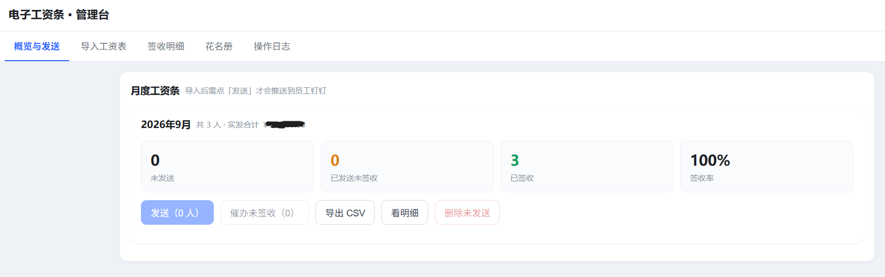
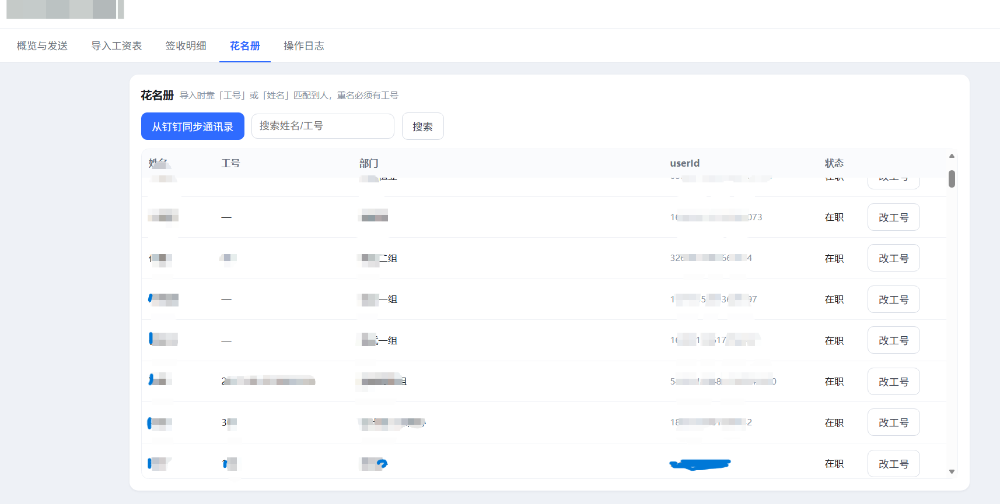
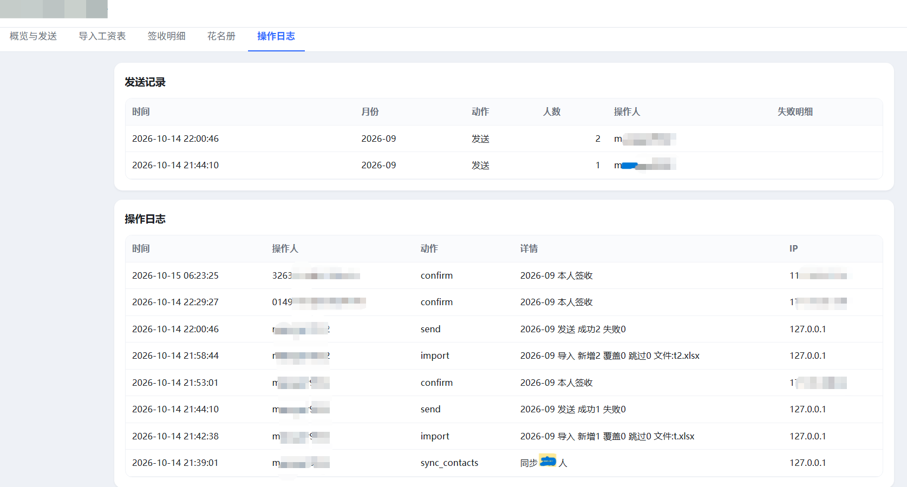

<div align="center">

# 📋 Payslip H5

**基于钉钉免登的电子工资条系统 · 自托管 · 数据不出企业**

HR 上传工资表 Excel，系统自动解析、校验、匹配员工，通过钉钉工作通知逐人推送；员工在钉钉内免登录打开查看，一键确认签收并留存时间 / IP / 设备证据。工资数据 100% 留在自己的服务器上，代码不到 3000 行，可审计、可改造。

[](./LICENSE)
[](https://nodejs.org)
[](https://mariadb.org)
[](https://open.dingtalk.com)
[](./package.json)

`Node.js` `Express` `MySQL` `钉钉H5` `原生JS · 无构建步骤`

---

**员工端 · 钉钉工作通知推送 → 打开查看明细 → 一键确认签收**

 

<br>

**概览与发送 · 签收率一目了然**



<br>

**导入工资表 · 表头自动识别，导入前逐行对账**

 

<br>

**签收台账 · 花名册 · 全量操作审计**

  

---

**如果这个项目帮到了你，欢迎点个 Star ⭐**

</div>

技术栈刻意保持“无聊”：Node.js + Express + MySQL/MariaDB + 原生前端（无构建步骤）。改完文件传上去重启即生效，适合没有专职前端/运维的中小团队。

**为什么做这个**：市面上按人头付费的工资条 SaaS 在 100+ 人规模下成本可观，且工资数据必须交给第三方。这套方案数据完全留在自己的服务器上，代码不到 3000 行，可审计、可改造。

---

## 目录

- [选型与取舍](#选型与取舍)
- [功能特性](#功能特性)
- [架构](#架构)
- [环境要求](#环境要求)
- [快速开始](#快速开始)
- [配置项](#配置项)
- [钉钉开放平台配置](#钉钉开放平台配置)
- [核心设计说明](#核心设计说明)
- [安全模型](#安全模型)
- [踩坑记录](#踩坑记录)
- [API 一览](#api-一览)
- [数据模型](#数据模型)
- [二次开发](#二次开发)
- [限制与不适用场景](#限制与不适用场景)

---

## 选型与取舍

企业内做工资条有三种常见形态，本项目选第 2 种：

| 方案 | 免登能力 | 开发/运维成本 | 界面可控 | 适用 |
|---|---|---|---|---|
| 多维表格 + 自动化工作流 | 无需开发 | 极低 | 差（受平台限制） | <100 人、想立刻用起来 |
| **钉钉 H5 微应用（本方案）** | 支持，`dd.runtime.permission.requestAuthCode` | 中 | 高 | 100~2000 人，需要定制与留痕 |
| 钉钉小程序 | 支持 | 高（每次改动需开发者工具上传版本、走发布） | 高 | 需要大量调用端能力时 |

选 H5 而非小程序的关键理由：工资条是"一个月用一次、界面简单"的内部工具，H5 部署即生效、可用任意 CSS、浏览器就能调试；小程序每次改样式都要走一次版本上传，收益不匹配。企业内部 H5 应用与小程序的免登能力是等价的。

---

## 功能特性

**员工侧**
- 钉钉内免登，无需账号密码，打开即是自己
- 卡片式工资条：实发合计突出显示，收入/扣款项分组，金额右对齐带千分位
- 个人提醒条（来自工资表的备注列，如"本月有代扣事项"）
- 一键确认签收，留存确认时间、来源 IP、User-Agent
- 历史月份切换查询

**HR 侧**
- 拖拽上传 Excel，自动定位表头行、按别名字典识别列
- 导入前预检：逐行交叉校验合计，问题行精确到行号与差额
- 按部门/状态/姓名筛选，勾选定向发送（支持全选、只选未发送、反选）
- 工作通知群发 + 催办未签收 + 重置为未发送
- 导出签收台账 CSV（含确认时间与 IP）
- 从钉钉通讯录同步花名册
- 全量操作审计日志

**工程**
- 工资项集中在单个配置文件，增删字段无需改表结构（明细存 JSON）
- 无前端构建步骤，无重型依赖（6 个生产依赖）
- 每日自动备份脚本、systemd 单元、nginx 配置样例

---

## 架构

```
员工钉钉 ──工作通知卡片──> H5 页面 ──HTTPS──> Nginx ──> Node/Express ──> MySQL
   ^                                                    │
   └────── 钉钉开放平台 API（免登/通讯录/工作通知）<──────┘

HR 浏览器 ──> 管理台（同一服务的静态页 + /api/admin/*）
```

```
server.js              入口：安全头、限流、静态托管、错误处理
src/config.js          配置装载与启动自检
src/fields.js          ★ 工资项定义 + 表头归一化 + 合计计算与对账
src/importer.js        Excel 解析、列映射、人员匹配、预检与落库
src/dingtalk.js        token/ticket 缓存、jsapi 签名、免登、通讯录同步、工作通知与投递结果
src/card.js            通知卡片文案（预览与正式发送共用同一构造器）
src/auth.js            会话签发、管理员判定、审计日志、真实客户端 IP
src/routes.js          接口层
public/                员工端 index.html + 管理台 admin.html + 原生 JS
scripts/init.sql       建表
deploy/                nginx 样例、systemd 单元、备份脚本
```

---

## 环境要求

- Node.js ≥ 18（用到全局 `fetch`）
- MySQL 5.7+ 或 MariaDB 10.2+（用到 JSON 列与 `JSON_EXTRACT`）
- 一个 **公网 HTTPS 域名**（钉钉免登硬性要求；内网/自签证书不可用）
- 钉钉企业账号 + 开发者后台管理员权限

---

## 快速开始

```bash
# 1. 获取代码
git clone <your-repo> payslip-h5 && cd payslip-h5
npm install --omit=dev

# 2. 配置
cp .env.example .env
openssl rand -hex 32        # 输出填入 JWT_SECRET
chmod 600 .env

# 3. 建库（建议用独立账号，不要用 root）
mysql -u root -p -e "CREATE USER 'payslip'@'localhost' IDENTIFIED BY '<强密码>';
GRANT ALL PRIVILEGES ON payslip.* TO 'payslip'@'localhost'; FLUSH PRIVILEGES;"
npm run init-db

# 4. 起服务
node server.js                       # 前台试跑
systemctl enable --now payslip       # 或 systemd 常驻（见 deploy/payslip.service）

# 5. 反向代理 + HTTPS
# 参照 deploy/nginx-payslip.conf，把应用反代到你的域名 443 端口
curl https://your-domain/healthz     # 期望 {"ok":true,...}
```

首次使用顺序：**登录管理台 → 同步钉钉通讯录 → 导入工资表（先预检）→ 勾选 1~2 人试发 → 手机确认排版与金额 → 全员发送**。

---

## 配置项

| 变量 | 说明 |
|---|---|
| `PORT` | 应用监听端口，仅绑 `127.0.0.1`，由 Nginx 反代对外 |
| `PUBLIC_BASE_URL` | 本应用的公网地址，**必须与钉钉里实际打开的地址完全一致**（协议、域名、端口、末尾斜杠），否则免登签名校验失败 |
| `DING_CORP_ID` / `DING_APP_KEY` / `DING_APP_SECRET` / `DING_AGENT_ID` | 钉钉企业内部应用凭证 |
| `DING_JSAPI_URL` | 钉钉 JSAPI 的 CDN 地址，失效时按官方文档换版本号 |
| `DB_*` | 数据库连接 |
| `JWT_SECRET` | 会话签名密钥，用 `openssl rand -hex 32` 生成 |
| `JWT_TTL_HOURS` | 会话有效期，默认 12 |
| `ADMIN_JOB_NUMBERS` | 管理员工号白名单 |
| `ADMIN_USER_IDS` | **推荐用这个**：管理员 userId 白名单。很多企业的钉钉「工号」字段质量不可控（实测有被填成员工入职日期的情况），userId 稳定唯一 |
| `ADMIN_PASSWORD` | 电脑浏览器登录用的备用口令，需与「工号或姓名」配合使用；生产建议留空禁用 |
| `DEV_MODE` | 调试登录开关，**上线必须为 0** |

> ⚠️ `.env` 的值不要含 `#`：`dotenv` 会把 `#` 之后当行内注释截掉，表现为"密码明明正确却总报不正确"。

---

## 钉钉开放平台配置

在 [开发者后台](https://open-dev.dingtalk.com) 创建**企业内部应用**，逐项配置：

| 位置 | 配置 | 不配的后果 |
|---|---|---|
| 应用能力 → **网页应用** | 移动端首页 `https://域名/`；PC 端首页可指向 `admin.html` 以区分员工端与管理入口 | 免登报错 1002/9「对应企业没有该域名微应用」 |
| 应用能力 → 可见范围 | **全部员工** | 工作通知只发给可见范围内的人，范围外的人静默收不到 |
| 权限管理 | 开通 `qyapi_get_department_list`（部门列表）、`qyapi_get_member`（部门成员） | 同步花名册被拒 |
| 开发配置 → 安全设置 → IP 白名单 | 服务器**公网出口 IP**（不是 CDN 节点 IP） | 调用服务端 API 被拒 |
| 安全设置 → 端内免登地址 | 本应用域名 | 决定免登能否用 |
| 安全设置 → 重定向 URL | OAuth 回调用；本项目走端内免登，填域名占位即可 | — |
| 版本管理与发布 | 创建版本 → **发布** | 所有改动不生效，员工也打不开 |

**重要**：企业内部应用调用工作通知 `asyncsend_v2` **不需要申请任何权限点**，权限列表里搜不到是正常的。它的前置条件只有三个：应用已发布、目标人在可见范围内、`agent_id` 正确。

改完任何配置都要**重新发布版本**才生效。

---

## 核心设计说明

这一节是本项目最值得复用的部分——都是真实数据磨出来的判断。

### 1. 工资项作为单一事实来源

`src/fields.js` 用一份数组描述所有工资项：

```js
{ key: 'base', label: '基本工资', group: 'income', agg: 'add' }
{ key: 'perfCoef', label: '部门绩效系数', group: 'income', agg: 'none' }   // 仅展示
{ key: 'otherDeduct', label: '各项扣款', group: 'income', agg: 'minus' }   // 从应发中减
{ key: 'gross', label: '应发数合计', group: 'income', agg: 'sub' }         // 小计
```

`agg` 语义：`add` 累加 / `minus` 减项 / `none` 仅展示 / `sub` 小计 / `total` 合计。导入映射、页面渲染、合计校验全部由这份数组驱动，**新增工资项只改这里，数据库不用动**（明细存 JSON）。

### 2. 表头归一化：真实 Excel 一定比你想的脏

```js
normalizeHeader(raw)
  → 去掉括号注释：'实发合计（元）' → '实发合计'
  → 剥掉所有非文字数字字符：换行、斜杠、空格、全半角符号
```

真实场景：HR 用**单元格内换行**写表头，"加班费↵补助" 实际等价于 "加班费/补助"。不归一化会导致整列被静默丢弃，进而合计全错，且极难定位。

匹配还做两级容错：
- 去掉 `代扣/应扣/扣除/减` 前缀再试一次（很多工资表列名叫"代扣社保"）
- 备注/姓名/工号允许包含式匹配（"备注说明"、"员工姓名"）

**识别不了的列一定要在预检里显式列出来**。本项目最初的合计错误，根因就是一列被忽略而没人察觉。

### 3. 合计对账：声明值优先 + 分级容差

这是最容易做错的一点。**不要用系统重算值覆盖 HR 表里的合计**——工资表是银行实际发放依据，覆盖了会导致员工看到的金额与到账金额不一致，制造投诉。

正确做法：以表内合计为准，系统算值只用于交叉校验，按差额分级处理：

```js
差异 ≤ 1 元   → 视为 Excel 取整（HR 常对合计做 ROUND(...,0)），放行 + 黄字提醒
差异 > 1 元   → 拦下该行
表内自相矛盾（应发 − 代扣 ≠ 实发）→ 拦下
```

硬拦一切会让系统在日常使用中频繁卡死；无脑放行则失去防错能力。分级容差是两者之间唯一实用的位置。

### 4. 人员匹配：姓名优先，工号只做消歧

理想情况下用工号匹配最稳。现实是：企业钉钉通讯录的「工号」字段经常是空的或被误填成入职日期，而工资表里的工号列也可能整列空白。

所以顺序设计为：

```
姓名在花名册中唯一  → 直接匹配
姓名有重名          → 要求工号消歧，消歧失败则报错并提示去补工号
姓名找不到          → 回退用工号兜底（应对姓名带空格、繁简差异）
```

配套两个防护：
- **同步通讯录时清洗工号**：日期形态的值一律置 NULL，别让它污染匹配和界面
- **工号撞号即视为不可用**：两个不同人共用一个工号时，宁可退回姓名匹配也不冒匹配错人的险

### 5. 工作通知是异步接口

`asyncsend_v2` 返回 `errcode=0` **只代表消息入队**，不代表每个人都收到了。必须再查一次：

```
POST /topapi/message/corpconversation/getsendresult  { agent_id, task_id }
  → send_result.failed_user_id_list
```

本项目的处理：发送后等待约 1.5 秒查询投递结果，**投递失败的人保持 `pending` 状态**，界面列出姓名。这样 HR 修正可见范围后可直接重发，也不会出现"系统显示已发送 150 人，实际有 2 人没收到"这种最难排查的情况。

另外 `userid_list` 单次上限 100 人，代码按 100 分批。

### 6. 状态机与定向发送

```
pending（未发送）→ sent（已发送）→ confirmed（已签收）
```

发送动作**只挑 pending**，所以天然幂等、不会重复轰炸。重测需要显式的「重置为未发送」，它会同时清掉发送时间和签收凭证，因此界面必须二次确认并明确提示"其中 N 人已签收"。

定向发送（勾选若干人先试）在正式上线前非常关键——它让"小范围真实验证"成为可能，而不是只能全员发或只能不发。

### 7. 卡片文案的渲染陷阱

钉钉 ActionCard 的 markdown 里，**行内加粗的字号会被渲染得比正文小**：

```
**张三** 你好，本月实发合计 ￥1234.00    ← "张三"看起来异常小
```

要突出的内容独立成行：

```
**2026年9月 工资条**

姓名：张三

实发合计：**￥1234**

> 点击查看完整明细，核对后请确认签收
```

另外段落之间必须有空行才会真正换行。把文案抽成独立模块（`src/card.js`），让"预览测试"和"正式发送"共用同一构造器，避免测试通过但线上格式不一致。

---

## 安全模型

**已实现的**

- **数据隔离在后端**：员工侧接口一律用会话中的 `userId` 查询，不接受任何客户端传入的用户标识，无法越权读取他人工资
- **会话**：JWT，默认 12 小时过期；**只接受 `Authorization: Bearer`**，明确不支持 URL 携带令牌（令牌进 URL 会落入 Nginx/CDN 访问日志，可被重放）
- **传输**：强制 HTTPS，HTTP 301 跳转
- **登录限流**：按 IP + 路径计数，每分钟超 20 次返回 429
- **口令登录双因子**：需「工号或姓名 + 口令」，且该人必须在管理员白名单内，因此审计日志记录的是真实身份而非一个笼统的账号
- **注入防护**：全部 SQL 参数化；前端所有插值经 HTML 转义；CSV 导出对 `= + - @` 开头的单元格加前缀，阻断 CSV 公式注入（`=HYPERLINK(...)` 类攻击）
- **缓存隔离**：`/api/*` 强制 `Cache-Control: no-store`——域名走 CDN 时，若边缘缓存了某个员工的响应，会把 A 的工资条返回给 B，这是数据泄露而非性能问题
- **最小权限**：数据库独立账号仅授权本库；应用只监听 `127.0.0.1`；`.env` 权限 600
- **审计留痕**：导入、发送、催办、重置、导出、签收全部写日志，签收额外记录 IP 与 UA

**未实现的（部署者需自行评估）**

- 金额字段明文存储。如需静态加密，可加 AES-256-GCM 加密列（代价是无法在 SQL 层聚合）
- 无多租户/多主体隔离，一套部署服务一个法人主体
- 无字段级权限（管理员可查看全部明细，这是"能操作发薪"的必然结果）
- 无二次确认的敏感操作闸门（依赖界面 confirm）
- 备份仅在本机，需自行做异地副本

**责任边界**：工资数据属敏感个人信息。自托管意味着安全责任的转移——服务器补丁、面板端口收敛、备份可用性都需要人负责。上线前建议至少做一次外部端口扫描，确认各内部端口没有被公网直接可达。

---

## 踩坑记录

| 现象 | 根因与解法 |
|---|---|
| 调用外部 API 偶发 `ETIMEDOUT`，堆栈含 `internalConnectMultiple` | Node 20 默认双栈并发连接，服务器 IPv6 路由不通时会先等 IPv6 超时。`curl` 会自动快速回退所以命令行看不出来。解法：`dns.setDefaultResultOrder('ipv4first')` |
| 改了前端但用户看到的还是旧版 | CDN 会缓存 `.js/.css`。解法：给静态资源加 `?v=` 版本号并每次改动递增；同时给 CDN 配 `/api/*` 不缓存 |
| 免登报 1002/9 | 九成是「网页应用」能力没添加、或端内免登地址没配、或改完没重新发布版本 |
| 工作通知"发送成功"但有人没收到 | 该人不在应用可见范围内；必须查 `getsendresult` 才知道 |
| 合计大面积对不上 | 通常是某一列被静默忽略。预检界面必须显式列出未识别列 |
| 用面板工具改 Nginx 配置后，手写的防护规则消失 | 图形化面板会重写配置文件。改完要在面板里补录一份 |
| 导入的工号列出现 `2017-08-22 00:00:00` | 通讯录里工号字段被填成了日期。同步时清洗为 NULL |
| 清理数据时误删真实记录 | **动手前先查状态分布与操作日志**，不要凭界面截图推断"应该还没导入" |

---

## API 一览

**公开**
```
GET  /healthz                    健康检查
GET  /api/meta                   应用元信息与工资项定义
POST /api/js-sign                jsapi 鉴权签名（需传当前页面完整 URL）
POST /api/auth/login             钉钉免登 code 换会话
POST /api/auth/password          工号/姓名 + 口令登录（电脑端）
POST /api/auth/dev               调试登录（仅 DEV_MODE=1）
```

**员工侧**（需会话）
```
GET  /api/me/months              我的月份列表
GET  /api/me/payslip?month=      我的某月工资条明细
POST /api/me/confirm             确认签收（记录时间与 IP/UA）
```

**管理侧**（需管理员会话）
```
GET  /api/admin/overview         各月统计
GET  /api/admin/payslips         明细查询（month/status/dept/kw）
GET  /api/admin/depts            部门汇总
POST /api/admin/import/preview   导入预检（不落库）
POST /api/admin/import/commit    确认导入（mode=overwrite|skip）
POST /api/admin/send             发送（可选 userIds 定向、personalized 个性化）
POST /api/admin/remind           催办未签收
POST /api/admin/reset-pending    重置为未发送（需显式 confirm）
POST /api/admin/drop-pending     删除未发送数据
POST /api/admin/employees/sync   同步钉钉通讯录
POST /api/admin/employees/bind   手工补工号
GET  /api/admin/export.csv       导出签收台账
GET  /api/admin/logs             操作日志
```

---

## 数据模型

```sql
employees   (user_id PK, name, job_number, dept_name, mobile, active, updated_at)
payslips    (id PK, pay_month, user_id, name, job_number, dept_name,
             items JSON, gross_amount, deduct_amount, net_amount,
             status ENUM('pending','sent','confirmed'), batch_id,
             sent_at, confirmed_at, confirm_ip, confirm_ua, created_at,
             UNIQUE(pay_month, user_id))
import_batches (id, pay_month, filename, total_rows, ok_rows, skip_rows, operator, created_at)
send_logs   (id, pay_month, action, target_count, task_ids, failed, operator, created_at)
admin_logs  (id, actor, action, detail, ip, created_at)   -- 只追加，用于事后还原事实
```

工资项存 `items` JSON 而非固定列，因此增删字段不需要 DDL。`pay_month` 语义是**工资所属月**而非发放月，界面显示与归档都以它为准。

---

## 二次开发

**加一个工资项**：在 `src/fields.js` 的 `FIELDS` 数组加一行，并在 `HEADER_ALIASES` 补上它可能的表头叫法。导入映射、员工端渲染、管理台明细、CSV 台账、合计校验会自动跟随。

**改通知卡片样式**：只改 `src/card.js`。

**改校验容差**：`src/fields.js` 的 `SOFT_TOLERANCE`。

**换通知形态**（如改成 OA 审批、待办、群机器人）：只需替换 `src/dingtalk.js` 的 `sendWorkNotice`，其余逻辑不依赖具体通道。

---

## 限制与不适用场景

- 需要公网 HTTPS 域名和钉钉企业内部应用创建权限，个人开发者无法完整验证
- 面向单一法人主体，不适合集团多主体分账发放
- 「一键确认」是操作留痕，不等于符合《电子签名法》要求的可靠电子签名。若企业需要强法律效力，需接入第三方电子签或在员工端加手写签名（本项目架构支持扩展，未内置）
- 未做国际化，界面与表头别名为中文
- 无并发写冲突处理（同月多人同时导入会互相覆盖），设计上假定 HR 单人操作

---

## 许可与免责声明

MIT

本软件不作任何明示或暗示的保证。
工资数据高度敏感，请在正式使用前自行完成安全评估、权限验证与数据备份演练。
作者不对因使用本软件造成的数据泄露、金额错误、发放延误承担任何责任。
